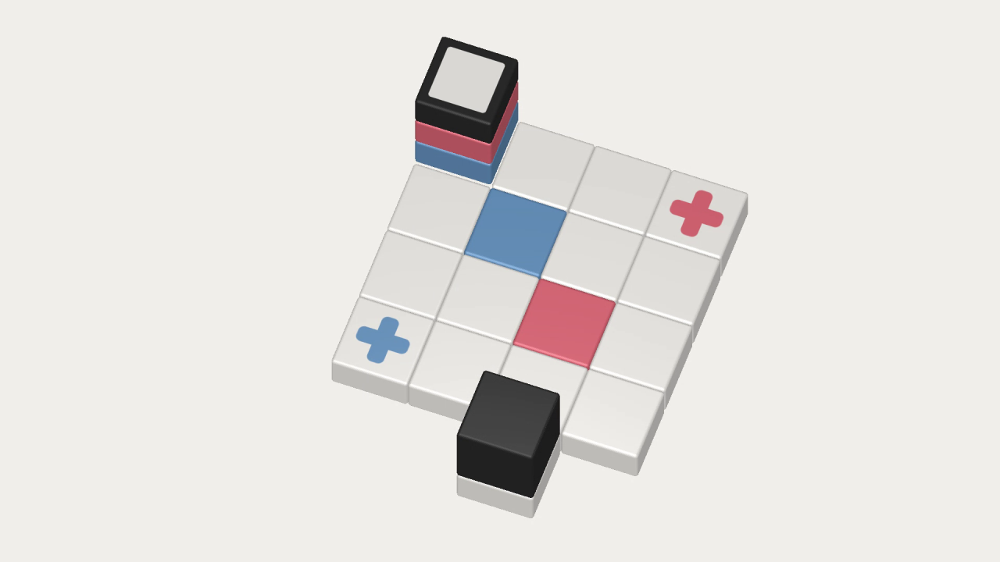

# Cubicolor

Cubicolor is a minimalist puzzle game. The rules are simple: Match the color patches on the board and reach the exit, all on one single path. The game gets harder as the levels progress, always accompanying you with soothing piano tunes.

[Cubicolor on Steam](https://store.steampowered.com/app/454190/Cubicolor/)

**Note:** The `master` branch holds the current re-implementation of the game in C# / .NET, running natively on macOS (Metal), Windows (Direct3D 11) and Linux (Vulkan) without third-party dependencies. The original Java version (v1.1, libGDX, 2016) lives on the `libgdx` branch, the Godot engine version (v1.2, 2018) on the `godot` branch.

